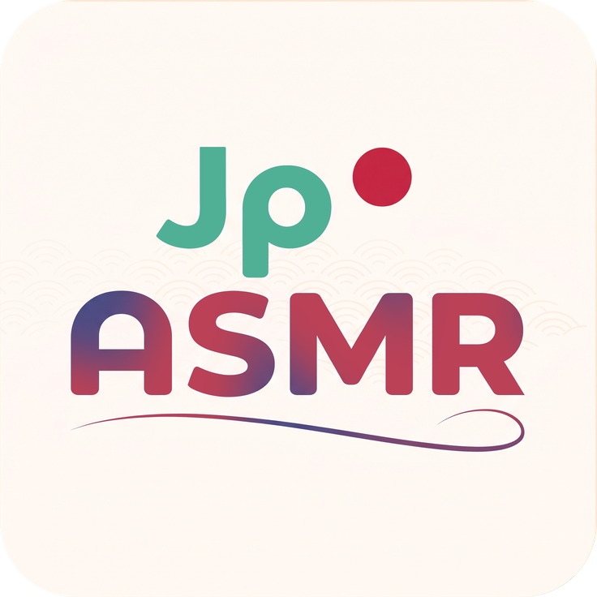

<div align="center">
  
  <h1>JapaneseASMR Downloader</h1>
  <p><b>A modern all-in-one desktop application to download, merge, tag, and play Japanese ASMR audio works.</b></p>

  <p>
    <b>English</b> |
    <a href="README_ID.md">Bahasa Indonesia</a> |
    <a href="README_JA.md">日本語</a> |
    <a href="README_ZH.md">简体中文</a>
  </p>

  <p>
    <a href="https://github.com/SayMaven/japaneseasmr-dl/releases/latest"></a>
    <a href="https://github.com/SayMaven/japaneseasmr-dl/blob/main/LICENSE"></a>
    
    
    
  </p>

  <p>
    <a href="#key-features">Key Features</a> •
    <a href="#architecture--tech-stack">Tech Stack</a> •
    <a href="#installation--usage">Download & Install</a> •
    <a href="#running-from-source-code-developer-mode">Building</a> •
    <a href="#project-structure">Project Structure</a> •
    <a href="#license">License</a>
  </p>
</div>

---

## Key Features

### 1. Modern Desktop GUI & Multilingual Support
- **Full Internationalization (i18n)**: Supports English, Bahasa Indonesia, Japanese (日本語), and Simplified Chinese (简体中文). Automatically adapts to your Windows system language by default, with dynamic in-place language switching in Settings.
- **Flat & Dark Theme UI**: Built with a clean, eye-friendly Dracula / Catppuccin color scheme.
- **Real-Time DLsite Metadata & Cover Art**: Displays official DLsite work details and HD cover art:
  - Full Work Title
  - Voice Actors (*Multi-CV / Seiyuu*)
  - Circle / Maker Name
  - Age Rating (*All-Ages / R18*)
  - Genres & Official Tags
- **Flexible Queue System**: Add multiple RJ codes or URLs at once (e.g., `RJ01673437`, `RJ278932`, asmr.one links, japaneseasmr links, or DLsite URLs) separated by spaces or commas.
- **Persistent History & Library Statistics**: Automatically archives downloaded works with offline cover thumbnails, disk usage statistics, and direct player integration.

### 2. Built-in Audio Player (*Native Windows Media Foundation*)
- **High-Performance Native Engine**: Powered by Windows Media Foundation (`NativeMFPlayer`), playing `.m4a`, `.mp3`, `.wav`, `.flac`, and `.aac` with zero lag, instant seek, and low CPU usage.
- **Interactive Chapter Panel**: View scenes and chapters in real-time. Double-click any chapter to jump directly to that timestamp, featuring active chapter highlighting.
- **Recursive Directory Scanner**: Automatically scans your library folder including all nested subfolders, recognizing audio files and displaying matching local or remote cover art.
- **Full Playback Controls**: Interactive timeline slider, volume control (0% – 100%), loop mode, previous/next track navigation.

### 3. High-Speed Downloader Engine & Dual-Source Fallback
- **Dual-Source Audio Engine**: Prioritizes `japaneseasmr.com` (`weeab0o.xyz`), seamlessly falling back to `asmr.one` if the work is not yet indexed on the primary source.
- **Smart Track Filter Heuristics**: When falling back to `asmr.one`, the engine automatically filters out raw multi-gigabyte WAV duplicates, stem audio, sound effects, and ambient noises, downloading only the essential story tracks (`本編`) and narrative bonus tracks.
- **Smart Fast Remux & Chapters**: Instant lossless stream-copy remux for AAC audio into M4A with embedded chapter atoms, or high-quality MP3 encoding with companion `.cue` sheets.
- **Multi-Tier HD Cover Art Fallback**: High-resolution artwork guarantee: CDN JapaneseASMR -> DLsite Official Full HD (`img.dlsite.jp`) -> CDN asmr.one.
- **aria2c Parallel Acceleration**: Uses `yt-dlp` powered by `aria2c` with optimized connection pooling (up to 16 parallel threads per stream).
- **Embedded Tagging**: Injects JPEG cover art, title, artist (CV), album (Circle), genre, and chapter markers into ID3v2 / MP4 containers.
- **Self-Updating Engine**: Update `yt-dlp` directly inside Settings with either **Stable** or **Nightly** update channels.

### 4. Storage & Cache Management
- **Custom Download Location**: Freely configure and switch download folders anytime.
- **One-Click Cache Cleaning**: Monitor and clear thumbnail caches (`.cache/covers/`) and temporary download chunks (`.cache/temp/`).
- **Flexible Output Formats**: Choose between Auto (M4A Fast Remux / MP3), M4A Native, or MP3 CBR 320k.
- **File Naming Options**: Standard RJ code naming or full original work titles.

---

## Architecture & Tech Stack

JapaneseASMR Downloader adheres to a modular, lightweight desktop architecture with native Windows optimization and zero external runtime dependencies when installed:

| Layer | Component | Description |
| :--- | :--- | :--- |
| **UI Framework** | Tkinter & `ttk` | Declarative responsive desktop GUI, custom canvas timeline slider, and modern dark theme |
| **Media Engine** | Windows Media Foundation (`NativeMFPlayer`) | Hardware-accelerated native audio decoding, instant seeking, and interactive chapter sync |
| **Audio Processing** | FFmpeg & FFprobe | Zero-copy AAC stream remuxing (`.m4a`), ID3v2/MP4 chapter atom injection, and CUE sheet export |
| **Download Pipeline** | yt-dlp + aria2c | Multi-source fallback (`japaneseasmr` / `asmr.one`) with parallel multi-connection acceleration |
| **Metadata Scraper** | `urllib` & DLsite Parser | Real-time DLsite metadata extraction (CV, Circle, Tags, HD Cover Art) with regex sanitize filters |
| **Image Processing** | Pillow (PIL) | Asynchronous cover art loading, thumbnail generation, and multi-resolution icon rendering |
| **Internationalization (i18n)** | Win32 API (`ctypes`) + JSON Catalog | Live zero-restart UI re-rendering with automatic Windows UI locale detection |
| **Local Persistence** | JSON Storage (`config.json`, `history.json`) | Persistent user settings, library playback state, cover thumbnails cache, and download history |
| **Binary Compiler** | Nuitka | Standalone C-level compiled Windows executable with embedded Python runtime and native DLLs |
| **Installer & Setup** | Inno Setup 7 | High-ratio LZMA2/ultra64 compressed installer with 4-language setup wizard |

---

## System Requirements

When running from source code, ensure the following prerequisites are installed:

1. **Windows 10 / 11 (64-bit)**
2. **Python 3.8+** (Python 3.10 – 3.14 recommended)
3. **Pillow** (For GUI graphic rendering & icon processing):
   ```bash
   pip install Pillow
   ```
4. **Required Binary Tools** (place in `bin/` or add to system `PATH`):
   - **[yt-dlp](https://github.com/yt-dlp/yt-dlp)**
   - **[aria2c](https://github.com/aria2/aria2)**
   - **[ffmpeg](https://ffmpeg.org/)**

---

## Installation & Usage

### 1. Windows Installer (Recommended)
No Python or third-party tools installation required for regular users:
1. Download the latest installer **`JapaneseASMR_Setup_v1.1.1.exe`** from **[Releases](https://github.com/SayMaven/japaneseasmr-dl/releases)**.
2. Run the installer and follow the guided setup wizard.
3. Launch the application directly from your Start Menu or Desktop!

---

### 2. Running from Source Code (Developer Mode)

To run or develop directly from source:

1. **Clone the Repository**:
   ```bash
   git clone https://github.com/SayMaven/japaneseasmr-dl.git
   cd japaneseasmr-dl
   ```

2. **Install Python Dependencies**:
   ```bash
   pip install Pillow
   ```

3. **Verify Binary Dependencies**:
   Ensure **[yt-dlp](https://github.com/yt-dlp/yt-dlp)**, **[ffmpeg](https://ffmpeg.org/)**, and **[aria2c](https://github.com/aria2/aria2)** are available in system `PATH` or located in the `bin/` directory.

4. **Launch the Application**:
   * **Desktop GUI Mode (Primary)**:
     ```bash
     python main.py
     ```
   * **Interactive Terminal CLI Mode**:
     ```bash
     python cli.py
     ```

---

## Project Structure

```text
japaneseasmr-dl/
├── assets/                # App icons and graphics (icon.ico, icon.png)
├── config_manager.py      # Configuration, history, and audio pipeline manager
├── dlsite_scraper.py      # DLsite official scraper & filename sanitizer
├── gui.py                 # Desktop GUI, Native Audio Player, and Settings
├── i18n.py                # Internationalization module (EN, ID, JA, ZH)
├── main.py                # Desktop GUI main entry point
├── cli.py                 # Interactive Terminal CLI entry point
├── README.md              # English documentation (Default)
├── README_ID.md           # Indonesian documentation
├── README_JA.md           # Japanese documentation
├── README_ZH.md           # Simplified Chinese documentation
└── downloads/             # Default audio downloads directory
```

---

## License
This project is open-source and licensed under the **[GNU General Public License v3.0 (GPL-3.0)](LICENSE)**. Copyright © 2026 **SayMaven**.
