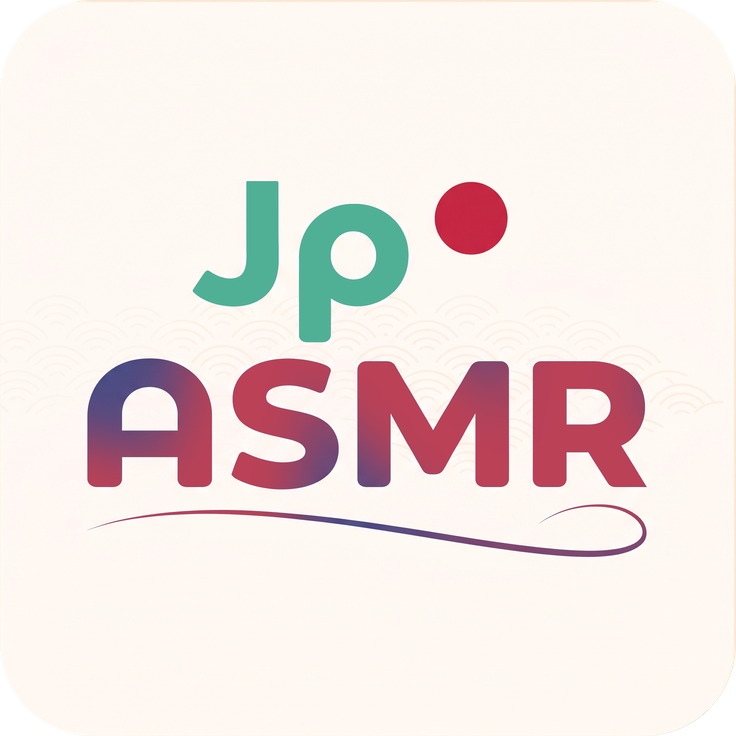

<div align="center">
  
  <h1>JapaneseASMR Downloader</h1>
  <p><b>Aplikasi desktop all-in-one modern untuk mengunduh, menggabungkan, menyematkan tag, dan memutar audio Japanese ASMR.</b></p>

  <p>
    <a href="README.md">English</a> |
    <b>Bahasa Indonesia</b> |
    <a href="README_JA.md">日本語</a> |
    <a href="README_ZH.md">简体中文</a>
  </p>

  <p>
    <a href="https://github.com/SayMaven/japaneseasmr-dl/releases/latest"></a>
    <a href="https://github.com/SayMaven/japaneseasmr-dl/blob/main/LICENSE"></a>
    
    
    
  </p>

  <p>
    <a href="#fitur-utama">Fitur Utama</a> •
    <a href="#arsitektur--tech-stack">Tech Stack</a> •
    <a href="#cara-instalasi--penggunaan">Unduh & Instalasi</a> •
    <a href="#menjalankan-dari-source-code-mode-pengembang">Mode Pengembang</a> •
    <a href="#struktur-proyek">Struktur Proyek</a> •
    <a href="#lisensi">Lisensi</a>
  </p>
</div>

---

## Fitur Utama

### 1. Antarmuka Desktop Modern (GUI) & Multi-Bahasa
- **Dukungan Multi-Bahasa (i18n)**: Mendukung Bahasa Indonesia, English, 日本語, dan 简体中文. Default mengikuti bahasa sistem Windows secara otomatis, dan dapat diganti secara dinamis tanpa restart.
- **Desain Flat & Dark Theme**: Menggunakan palet warna modern elegan (Dracula / Catppuccin) yang bersih, profesional, dan nyaman di mata.
- **Pratinjau Cover & Metadata Real-time**: Menampilkan gambar cover resolusi tinggi serta informasi karya dari DLsite resmi:
  - Judul Lengkap Karya
  - Pengisi Suara (*Multi-CV / Seiyuu*)
  - Nama Lingkar Karya (*Circle / Maker*)
  - Rating Usia (*All-Ages / R18*)
  - Genre & Tag Karya
- **Tabel Antrean Fleksibel**: Mendukung input banyak kode RJ sekaligus (misal: `RJ01673437`, `RJ278932`, tautan asmr.one, tautan japaneseasmr, atau DLsite URL) dipisahkan oleh spasi atau koma.
- **Penyimpanan Riwayat Koleksi**: Daftar riwayat karya yang pernah diunduh tersimpan secara otomatis, lengkap dengan statistik total koleksi, ukuran file di disk, dan cover thumbnail offline.

### 2. Pemutar Audio Bawaan (*Native Windows Media Foundation Player*)
- **Pemutar Musik Native Berkecepatan Tinggi**: Ditenagai Windows Media Foundation (`NativeMFPlayer`), memutar format `.m4a`, `.mp3`, `.wav`, `.flac`, dan `.aac` secara instan, presisi, dan bebas lag.
- **Daftar Bab Interaktif (*Interactive Chapters*)**: Menampilkan daftar bab/adegan cerita secara real-time. Klik ganda untuk lompat langsung ke bab tertentu, dengan highlight bab aktif otomatis.
- **Deteksi Audio Rekursif (Termasuk Subfolder)**: Secara otomatis memindai seluruh folder lokasi simpan beserta semua subfolder di dalamnya, mengenali semua format audio serta menampilkan cover art lokal/online yang sesuai.
- **Kontrol Interaktif**:
  - *Timeline slider* interaktif (geser untuk lompat ke detik yang diinginkan).
  - Kontrol Volume (0% – 100%).
  - Tombol Navigasi: Putar / Jeda, Berhenti, Track Sebelumnya, dan Track Berikutnya.
  - Mode Pemutaran Berulang (*Loop Track: ON/OFF*).

### 3. Engine Unduhan Berkecepatan Tinggi & Dual-Source Fallback
- **Dual-Source Audio Engine**: Mengutamakan sumber utama `japaneseasmr.com` (`weeab0o.xyz`), dan secara otomatis beralih ke sumber sekunder (*fallback*) `asmr.one` jika karya belum tersedia di JapaneseASMR.
- **Smart Track Filter Heuristics**: Saat beralih ke `asmr.one`, engine secara cerdas memfilter struktur direktori dan hanya mengunduh track cerita utama (`本編`) & omake naratif, secara otomatis mengabaikan file duplikat format (WAV vs MP3), sound bites, dan variasi ambient/stem.
- **Smart Fast Remux & Bab M4A / CUE Sheet MP3**: Remux lossless instan (stream copy) untuk audio AAC tanpa re-encoding, serta penanaman bab native M4A atau pembuatan CUE Sheet pendamping untuk MP3.
- **Multi-Tier HD Cover Art Fallback**: Menjamin cover art resolusi tinggi selalu tersedia dengan urutan prioritas: CDN JapaneseASMR -> DLsite Official Full HD (`img.dlsite.jp`) -> CDN asmr.one.
- **Akselerasi Multi-Thread**: Memanfaatkan engine `yt-dlp` yang dipercepat dengan `aria2c` (koneksi paralel optimal hingga 16 thread per stream).
- **Penyematan Metadata ID3v2 / MP4**: Menanamkan cover art HD JPEG, judul, artis (CV), album (Circle), genre, dan chapter markers langsung ke dalam file audio.
- **Pembaruan Engine yt-dlp Mandiri**: Terdapat fitur pembaruan `yt-dlp` langsung di menu Pengaturan dengan pilihan channel **Stable** (rilis stabil resmi) atau **Nightly** (rilis harian fitur terbaru).

### 4. Manajemen Penyimpanan & Pengaturan
- **Ganti Folder Unduhan**: Bebas mengatur folder tujuan penyimpanan file audio.
- **Manajemen Cache**: Pantau dan bersihkan cache gambar cover art (`.cache/covers/`) serta file partisi sementara (`.cache/temp/`) dalam sekali klik.
- **Opsi Format Audio**: Pilihan format audio output: Otomatis (M4A Fast Remux / MP3), M4A Native, atau MP3 320k.
- **Opsi Penamaan File**: Pilihan menggunakan kode RJ standar atau judul asli karya sebagai nama file audio.

---

## Arsitektur & Tech Stack

JapaneseASMR Downloader dirancang dengan arsitektur desktop modular yang ringan, optimal untuk Windows, dan mandiri (*standalone* tanpa perlu runtime tambahan bagi pengguna):

| Layer | Komponen | Deskripsi |
| :--- | :--- | :--- |
| **UI Framework** | Tkinter & `ttk` | Antarmuka desktop responsif bertema gelap modern, slider timeline canvas interaktif, dan tabel antrean dinamis |
| **Media Engine** | Windows Media Foundation (`NativeMFPlayer`) | Pemutaran audio native berakselerasi perangkat keras, pencarian durasi instan (seek), dan sinkronisasi bab (chapter) |
| **Pemrosesan Audio** | FFmpeg & FFprobe | Remux stream AAC lossless tanpa re-encoding (`.m4a`), injeksi atom chapter ID3v2/MP4, dan ekspor CUE sheet |
| **Download Pipeline** | yt-dlp + aria2c | Unduhan multi-koneksi paralel dipercepat dengan fallback ganda (`japaneseasmr` / `asmr.one`) |
| **Metadata Scraper** | `urllib` & DLsite Parser | Ekstraksi metadata resmi DLsite secara real-time (CV, Circle, Tag, Cover HD) dengan pembersih nama file |
| **Pemrosesan Gambar** | Pillow (PIL) | Pemuatan cover art asinkron, pembuatan thumbnail cache, dan rendering ikon multi-resolusi |
| **Internasionalisasi (i18n)** | Win32 API (`ctypes`) + JSON Catalog | Pergantian bahasa dinamis tanpa restart dengan deteksi otomatis bahasa sistem Windows |
| **Penyimpanan Lokal** | JSON Storage (`config.json`, `history.json`) | Konfigurasi aplikasi, status pemutar audio, cache thumbnail cover, dan riwayat unduhan |
| **Kompilasi Biner** | Nuitka | Executable mandiri hasil kompilasi level C dengan runtime Python terintegrasi dan dependensi DLL |
| **Installer & Distribusi** | Inno Setup 7 | Installer terkompresi tinggi LZMA2/ultra64 dengan wizard instalasi dalam 4 bahasa |

---

## Persyaratan Sistem

Sebelum menjalankan aplikasi dari *source code*, pastikan komponen berikut telah terpasang:

1. **Windows 10 / 11 (64-bit)**
2. **Python 3.8+** (Disarankan Python 3.10 – 3.14)
3. **Pillow** (Untuk manipulasi grafis & ikon GUI):
   ```bash
   pip install Pillow
   ```
4. **Binary Pendukung** (letakkan di folder `bin/` atau daftarkan di system `PATH`):
   - **[yt-dlp](https://github.com/yt-dlp/yt-dlp)**
   - **[aria2c](https://github.com/aria2/aria2)**
   - **[ffmpeg](https://ffmpeg.org/)**

---

## Cara Instalasi & Penggunaan

### 1. Menggunakan Installer Windows (Direkomendasikan)
Bagi pengguna umum, Anda **tidak perlu menginstal Python atau alat tambahan apa pun**:
1. Unduh installer terbaru **`JapaneseASMR_Setup_v1.1.1.exe`** dari menu **[Releases](https://github.com/SayMaven/japaneseasmr-dl/releases)**.
2. Jalankan installer dan ikuti petunjuk pemasangan hingga selesai.
3. Aplikasi siap digunakan langsung dari Start Menu atau Desktop!

---

### 2. Menjalankan dari Source Code (Developer Mode)

Jika Anda ingin menjalankan atau mengembangkan langsung dari kode sumber (*source code*):

1. **Clone Repository**:
   ```bash
   git clone https://github.com/SayMaven/japaneseasmr-dl.git
   cd japaneseasmr-dl
   ```

2. **Instal Dependensi Python**:
   ```bash
   pip install Pillow
   ```

3. **Pastikan Binary Engine Tersedia**:
   Pastikan **[yt-dlp](https://github.com/yt-dlp/yt-dlp)**, **[ffmpeg](https://ffmpeg.org/)**, dan **[aria2c](https://github.com/aria2/aria2)** telah terpasang di system PATH atau diletakkan di dalam folder `bin/`.

4. **Jalankan Aplikasi**:
   * **Mode Desktop GUI (Utama)**:
     ```bash
     python main.py
     ```
   * **Mode Terminal CLI (Interaktif)**:
     ```bash
     python cli.py
     ```

---

## Struktur Direktori Repository

```text
japaneseasmr-dl/
├── assets/                # Aset ikon dan grafis (icon.ico, icon.png)
├── config_manager.py      # Modul manajemen konfigurasi, riwayat unduhan, & probing stream
├── dlsite_scraper.py      # Modul scraping metadata DLsite resmi & sanitasi nama file
├── gui.py                 # Modul antarmuka GUI Desktop, Player, & Settings
├── i18n.py                # Modul lokalisasi multi-bahasa (ID, EN, JA, ZH)
├── main.py                # Entry-point utama Desktop GUI
├── cli.py                 # Entry-point mandiri Terminal CLI
├── README.md              # Dokumentasi utama (English)
├── README_ID.md           # Dokumentasi Bahasa Indonesia
├── README_JA.md           # Dokumentasi 日本語
├── README_ZH.md           # Dokumentasi 简体中文
└── downloads/             # Folder penyimpanan hasil unduhan audio
```

---

## Lisensi
Proyek ini dilisensikan di bawah **[GNU General Public License v3.0 (GPL-3.0)](LICENSE)**. Hak cipta © 2026 **SayMaven**.

