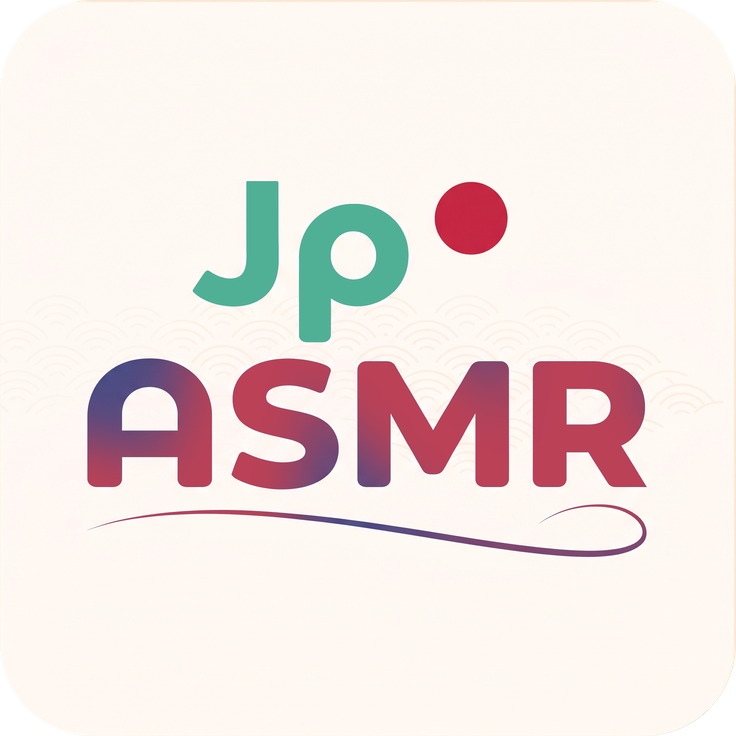

<div align="center">
  
  <h1>JapaneseASMR Downloader</h1>
  <p><b>Japanese ASMR 音声のダウンロード、自動結合、タグ埋め込み、再生を一本化した最新デスクトップアプリ</b></p>

  <p>
    <a href="README.md">English</a> |
    <a href="README_ID.md">Bahasa Indonesia</a> |
    <b>日本語</b> |
    <a href="README_ZH.md">简体中文</a>
  </p>

  <p>
    <a href="https://github.com/SayMaven/japaneseasmr-dl/releases/latest"></a>
    <a href="https://github.com/SayMaven/japaneseasmr-dl/blob/main/LICENSE"></a>
    
    
    
  </p>

  <p>
    <a href="#主な機能">主な機能</a> •
    <a href="#アーキテクチャ--使用技術tech-stack">Tech Stack</a> •
    <a href="#インストールと使い方">インストール</a> •
    <a href="#ソースコードからの実行開発者向け">開発手順</a> •
    <a href="#プロジェクト構成">プロジェクト構成</a> •
    <a href="#ライセンス">ライセンス</a>
  </p>
</div>

---

## 主な機能

### 1. モダンなデスクトップGUIと多言語対応
- **多言語完全対応（i18n）**: 日本語、英語、インドネシア語、中国語（簡体字）をサポート。デフォルトでWindowsのシステム言語に自動追従し、設定画面からリアルタイムに言語切り替えが可能です（再起動不要）。
- **洗練されたダークテーマ**: Dracula / Catppuccinをベースとした目に優しいフラットデザイン。
- **DLsite公式メタデータ＆カバー画像プレビュー**:
  - 作品タイトル
  - 出演声優（複数CV対応）
  - サークル名 / 制作元
  - 年齢指定（全年齢 / R18）
  - ジャンルおよび公式タグ
- **柔軟なキュー入力**: 複数のRJ番号（例: `RJ01673437`、`RJ278932`）、asmr.oneリンク、japaneseasmr記事URL、DLsite作品URLをまとめて一括追加可能。
- **ダウンロード履歴とライブラリ管理**: ダウンロードした作品をオフラインサムネイル画像やファイル容量統計とともに自動記録。

### 2. 内蔵オーディオプレーヤー（Windows Media Foundation）
- **高速ネイティブエンジン**: Windows Media Foundation（`NativeMFPlayer`）を採用し、`.m4a`、`.mp3`、`.wav`、`.flac`、`.aac`を遅延なく高音質・低負荷で再生。
- **インタラクティブ・チャプターパネル**: 再生中のシーンやチャプターをリアルタイム表示。ダブルクリックで目的のシーンへ即座にスキップ可能（再生中チャプターのハイライト表示機能付き）。
- **サブフォルダ再帰スキャン**: 保存先フォルダ内の全階層を自動スキャンし、既存の音声ファイルやカバー画像を即座に認識。
- **充実の再生コントロール**: シークバー、音量調整（0%〜100%）、1曲ループ再生、曲送り/曲戻し。

### 3. 高速ダウンロードエンジン＆デュアルソース自動フォールバック
- **デュアルソース対応**: `japaneseasmr.com`（`weeab0o.xyz`）を優先し、未登録作品の場合は自動的に`asmr.one`へとフォールバックして音声をシームレスに取得。
- **スマートトラック選別**: `asmr.one`の複雑なフォルダ構成から、本編音声（`本編`）およびストーリー特典のみを自動抽出し、不要な大容量WAV重複ファイルや効果音、環境音を賢くスキップ。
- **スマート高速リマックス**: AAC音声を再エンコードなしでM4A（チャプター原子内蔵）へ瞬時にロスレス結合。または高品質MP3（320k）とCUEシートの同時出力。
- **高画質カバー画像フォールバック**: JapaneseASMR CDN -> DLsite公式フルHD（`img.dlsite.jp`） -> asmr.one CDN の多段フォールバックで常に最高画質のカバーを取得。
- **aria2c マルチスレッド並列接続**: `yt-dlp`と`aria2c`を連携し、最大16並列ストリームによる最高速度のダウンロードを実現。
- **yt-dlp エンジン自動更新**: 設定ダイアログから安定版（Stable）または最新版（Nightly）を選択してワンクリックで更新可能。

### 4. ストレージと設定管理
- **保存先フォルダの自由変更**: いつでもダウンロード先ディレクトリを変更可能。
- **ワンクリックキャッシュ削除**: カバー画像キャッシュ（`.cache/covers/`）やダウンロード中の一時ファイル（`.cache/temp/`）を簡単にクリーンアップ。
- **ファイル命名設定**: 標準RJ番号形式または元の作品タイトル形式を選択可能。

---

## アーキテクチャ ＆ 使用技術（Tech Stack）

JapaneseASMR Downloader は、軽量かつモジュール化されたデスクトップ設計を採用し、Windows環境に最適化されています（インストーラー版は追加ランタイム不要）：

| レイヤー | コンポーネント | 説明 |
| :--- | :--- | :--- |
| **UIフレームワーク** | Tkinter & `ttk` | モダンなダークテーマ対応のレスポンシブデスクトップGUI、カスタムCanvasタイムライン、動的キュー |
| **メディアエンジン** | Windows Media Foundation (`NativeMFPlayer`) | ハードウェアアクセラレーションによる高速オーディオ再生、瞬時シーク、リアルタイム章（チャプター）同期 |
| **音声処理** | FFmpeg & FFprobe | AACストリームの無劣化リマックス（`.m4a`）、ID3v2/MP4チャプターアトムの埋め込み、CUEシート生成 |
| **ダウンロードパイプライン** | yt-dlp + aria2c | 並列マルチスレッド高速ダウンロードとデュアルソースフォールバック（`japaneseasmr` / `asmr.one`） |
| **メタデータスクレイピング** | `urllib` & DLsite Parser | DLsite公式情報のリアルタイム抽出（CV、サークル、タグ、高解像度カバー）およびファイル名安全化 |
| **画像処理** | Pillow (PIL) | 非同期カバー画像読み込み、サムネイルキャッシュ生成、マルチ解像度アイコン描画 |
| **国際化・多言語（i18n）** | Win32 API (`ctypes`) + JSON Catalog | 再起動不要の動的言語切り替えおよびWindowsシステム言語の自動検出 |
| **ローカルデータ保存** | JSON Storage (`config.json`, `history.json`) | ユーザー設定、再生履歴、カバーサムネイルキャッシュ、ダウンロード履歴の永続化 |
| **バイナリコンパイル** | Nuitka | PythonランタイムとDLLを内包したC言語レベルの最適化スタンドアロンWindows実行ファイル（.exe） |
| **インストーラー＆配布** | Inno Setup 7 | 高圧縮LZMA2/ultra64による軽量インストーラー（4言語セットアップウィザード対応） |

---

## 動作環境

ソースコードから実行する場合の必要環境:

1. **Windows 10 / 11 (64-bit)**
2. **Python 3.8+**（Python 3.10〜3.14推奨）
3. **Pillow**（画像処理ライブラリ）:
   ```bash
   pip install Pillow
   ```
4. **外部バイナリ**（`bin/`フォルダに配置するか、システム環境変数`PATH`に登録）:
   - **[yt-dlp](https://github.com/yt-dlp/yt-dlp)**
   - **[aria2c](https://github.com/aria2/aria2)**
   - **[ffmpeg](https://ffmpeg.org/)**

---

## インストールと使用方法

### 1. Windowsインストーラーを使用（一般ユーザー向け・推奨）
Pythonのインストールは不要です:
1. **[Releases](https://github.com/SayMaven/japaneseasmr-dl/releases)**から最新のインストーラー **`JapaneseASMR_Setup_v1.1.1.exe`** をダウンロードします。
2. インストーラーを起動し、画面の指示に従ってインストールします。
3. スタートメニューまたはデスクトップのショートカットからすぐに起動できます。

---

### 2. ソースコードから実行（開発者向け）

1. **リポジトリをクローン**:
   ```bash
   git clone https://github.com/SayMaven/japaneseasmr-dl.git
   cd japaneseasmr-dl
   ```

2. **依存パッケージのインストール**:
   ```bash
   pip install Pillow
   ```

3. **バイナリの確認**:
   `bin/`フォルダに`yt-dlp.exe`、`ffmpeg.exe`、`aria2c.exe`が配置されているか、またはシステムPATHに登録されていることを確認してください。

4. **アプリを起動**:
   * **デスクトップGUIモード（標準）**:
     ```bash
     python main.py
     ```
   * **ターミナルCLIモード**:
     ```bash
     python cli.py
     ```

---

## ライセンス
本プロジェクトは **[GNU General Public License v3.0 (GPL-3.0)](LICENSE)** のもとで公開されています。Copyright © 2026 **SayMaven**.

